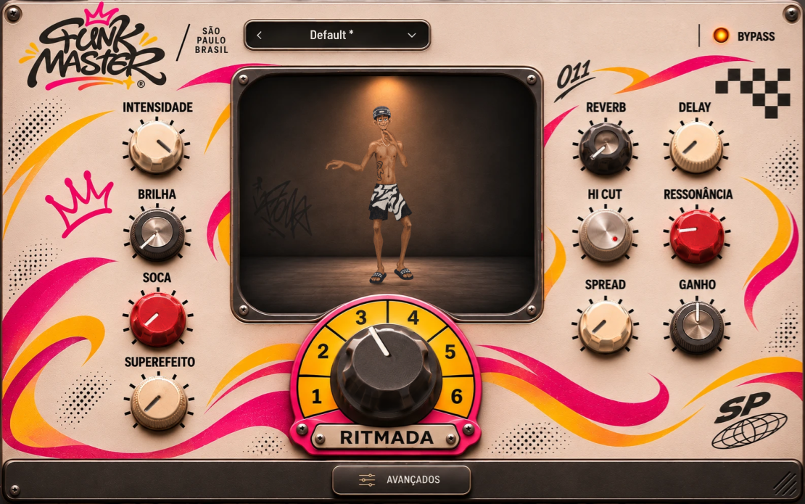
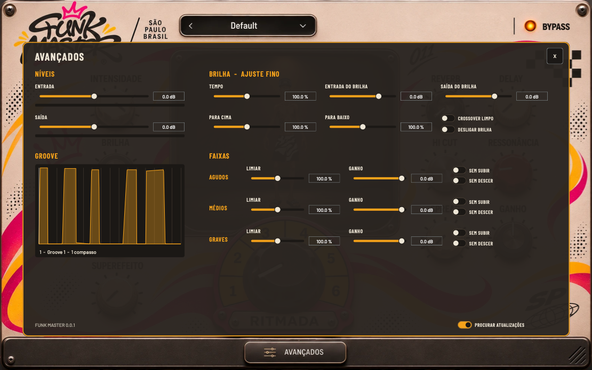

# FUNK MASTER

**O rack de funk da VVO Audio em forma de plugin (VST3 e Audio Unit) para macOS e VST3 para Windows.** Groove, brilho, soco, reverb, delay e o RITMADA dançando no palco enquanto você gira o botão.

**[⬇ Baixar a versão mais recente](https://github.com/vvoaudio/funkmaster-releases/releases/latest)**

> **Versão 0.0.3: versão de teste.** SUPEREFEITO e SOCA agora ajustados a partir de gravações do rack; SOCA no máximo e o HI CUT ainda estão em ajuste.

| | macOS |
|---|---|
| Arquivo | `FunkMaster-<versão>-macOS-Universal.pkg` |
| Requisito | macOS 11 Big Sur ou posterior |
| Macs | Apple Silicon (M1 e posteriores) ou Intel |
| Formato | VST3 + Audio Unit (AU) |
| Instala em | `/Library/Audio/Plug-Ins/VST3/` e `/Library/Audio/Plug-Ins/Components/` |

**Windows:** `FunkMaster-<versão>-Windows-Setup.exe`, VST3 de 64 bits, Windows 10 ou posterior, instala em `C:\Program Files\Common Files\VST3\`. O instalador não tem assinatura digital: se o Windows mostrar "O Windows protegeu seu PC", clique em **Mais informações** e depois em **Executar assim mesmo**.

## O que ele faz
- **RITMADA (botão grande, 1 a 6):** escolhe uma das 6 cadeias de efeito do rack, cada uma com o seu groove. O som troca de cadeia na hora em cada número. Com o projeto tocando, o RITMADA dança no tempo da sua DAW (cada passo cai no tempo); parado, ele acompanha o botão. Os ecos e o reverb da cadeia anterior continuam soando até sumir.
- **INTENSIDADE:** quanto o groove (bombeamento rítmico no tempo da sua DAW) mexe no volume.
- **BRILHA:** compressão multibanda que acende o som.
- **SOCA:** saturação (drive e mistura juntos).
- **SUPEREFEITO:** camada uma oitava acima, com chorus e textura.
- **REVERB / DELAY:** volume do reverb (plate) e do delay ping-pong sincronizado ao tempo.
- **HI CUT / RESSONÂNCIA:** filtro passa-baixa estilo Moog e a sua ressonância.
- **SPREAD:** abertura estéreo.
- **GANHO:** ganho final com limitador (−24 a +24 dB).
- **AVANÇADOS:** níveis de entrada e saída, ajuste fino do BRILHA e a visualização do groove.
- **Presets:** salve os seus próprios ajustes; o preset Default é o rack como ele foi salvo.
- Todos os botões podem ser automatizados na sua DAW.

## Instalar no Mac
1. Baixe o `.pkg` na [versão mais recente](https://github.com/vvoaudio/funkmaster-releases/releases/latest) e dê dois cliques nele.
2. O macOS vai avisar que não consegue verificar o desenvolvedor (o FUNK MASTER não está registrado na Apple). Clique em **Concluído** e abra
   **Ajustes do Sistema → Privacidade e Segurança**, role até o fim e clique em **Abrir Mesmo Assim** ao lado da mensagem do FunkMaster. Confirme com a sua senha.
3. Siga o instalador (ele pede a senha de administrador).
4. Reinicie a sua DAW ou procure plugins novamente (rescan) e carregue o **FUNK MASTER** entre os plugins VST3 ou Audio Unit (o Logic e o GarageBand usam o Audio Unit).

## Atualizando
Feche a sua DAW e execute o novo instalador da mesma forma. Ele substitui a versão antiga e mantém os seus presets e os seus projetos.

### Aviso de atualização
Uma vez por dia o FUNK MASTER pergunta ao GitHub qual é a versão mais recente (uma única requisição a `api.github.com`; nada mais é enviado). Se existir uma versão nova,
aparece o botão **ATUALIZAR AGORA** no alto da janela. Clique nele: o instalador é baixado, conferido com o checksum SHA-256 publicado e aberto. Nada é instalado sem você.
Para desligar a verificação, desligue **PROCURAR ATUALIZAÇÕES** no painel AVANÇADOS.

## Verificar o download
Cada versão publica um arquivo `SHA256SUMS.txt`. No Terminal: `shasum -a 256 FunkMaster-<versão>-macOS-Universal.pkg` e compare com a linha do arquivo.

---
FUNK MASTER © VVO Audio. Fonte Barlow Semi Condensed sob a licença SIL Open Font License (incluída no plugin).
